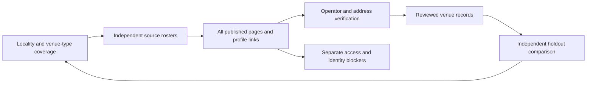

# Finding venues beyond the usual lists

Reviewed November 11, 2026 Pacific. This is a method comparison and an implementation record in progress, not proof of a complete Bay Area venue census.

The strongest approach combines a persistent crawl queue, independent source families, explicit geographic/category coverage, and reviewed property identities. A faster scraper alone does not establish recall: the share of relevant places actually found.

## Ten existing repositories worth distinguishing

These are complementary tools and examples. They were researched; they were not all installed or run. No paid service, proxy subscription, artificial engagement or access bypass is part of this work.

| Repository | What it actually contributes | Application to this search | Limit |
| --- | --- | --- | --- |
| [Scrapy](https://github.com/scrapy/scrapy) | A framework for following requests, extracting records and processing results. | Explicit directory pagination and profile queues, with a durable reason for every input outcome. | It follows the rules/seeds supplied; it does not know every venue. |
| [Crawlee](https://github.com/apify/crawlee) | HTTP and browser crawling, link enqueueing and local request storage. | Use ordinary retrieval first, rendered pages for missing dynamic content, and resumable work. | Rendering a page does not verify its facts or exhaust a directory. |
| [Playwright](https://github.com/microsoft/playwright) | Browser automation across Chromium, Firefox and WebKit. | Inspect real menus, expanded lists, embeds and client-rendered content when a static page is incomplete. | A browser is not permission to defeat a CAPTCHA or restriction. |
| [Deep-Deep](https://github.com/TeamHG-Memex/deep-deep) | A focused crawler that learns which links are likely to be relevant. | Prioritize likely rental/venue branches while retaining a queue of unexplored branches. | A relevance model can miss unusual venues; it must not silently discard low-scoring branches. |
| [Formasaurus](https://github.com/TeamHG-Memex/Formasaurus) | Classifies forms and fields, including contact, search, registration, mailing-list and order forms. | Distinguish an inquiry from a newsletter, payment form or reservation widget. | Automated form classification needs validation on actual rendered forms. |
| [google-maps-scraper](https://github.com/gosom/google-maps-scraper) | A local-business listing extraction project with geographic queries and place data. | A useful example of a separate discovery family and stable listing identifiers. | Reviewed as a method reference, not run here. Maps categories/results are not a census or wedding permission; no restriction-bypass features adopted. |
| [Trafilatura](https://github.com/adbar/trafilatura) | Web-content discovery and text/metadata extraction, including sitemaps and stored pages. | Reuse actual source bytes and compare extracted content against rendered pages. | Boilerplate removal can also remove meaningful inventory links; retain the original link list and bytes. |
| [OpenRefine](https://github.com/OpenRefine/OpenRefine) | Local data cleaning, reconciliation and enrichment. | Review aliases, spelling variations, branches and address mismatches. | Similar names are suggestions, not authority to merge two properties. |
| [Dedupe](https://github.com/dedupeio/dedupe) | Entity matching using structured data and human training examples. | Use name/address/operator evidence to propose duplicate groups for review. | Do not merge all properties using one operator domain, phone number or contact form. |
| [Common Crawl index table](https://github.com/commoncrawl/cc-index-table) | Tabular indexing of web archives. | Another route for discovering historical domains or lost page paths. | An archived page is historical evidence, not confirmation of present operations, price or wedding eligibility. Large query infrastructure is not required for the current bounded queue. |

## Written guidance that matters

- **Persist the queue and duplicate history.** Scrapy documents storing scheduled requests, visited-request filters and state for resumable jobs. Our collection writes each URL capture separately so an interruption does not erase finished work. [Scrapy job persistence](https://docs.scrapy.org/en/latest/topics/jobs.html)
- **Follow links and pagination deliberately.** Crawlee distinguishes request queues and supports breadth/depth traversal. A captured first page or the last page alone is insufficient: collect each page's actual profile IDs, continuation and termination evidence. [Crawlee request storage](https://crawlee.dev/js/docs/guides/request-storage)
- **Do not accidentally omit documents.** Scrapy's default link-extractor ignored extensions include PDF and several office formats. A venue-document workflow needs explicit handling rather than assuming a general crawler follows brochures. Our source collectors retain those links separately. [Scrapy link extractors](https://docs.scrapy.org/en/latest/topics/link-extractors.html)
- **Check published sitemaps and their indexes.** The sitemap protocol includes sitemap indexes; these provide additional published URL discovery routes. Absence from a sitemap does not establish absence from the site. [Sitemap protocol](https://www.sitemaps.org/protocol.html)
- **Document the search, not just the result count.** PRISMA-S provides a reporting checklist for reproducible literature searches. We adapt its source/query/date/deduplication traceability to venue discovery; it is not a venue-search validation standard. [PRISMA-S](https://www.prisma-statement.org/prisma-search)
- **Use multiple independent source types and sensitivity checks.** Cochrane's search chapter discusses source selection, search strategy and sensitivity. We adapt that search discipline to official inventories, tourism, directories, venue associations and vendor histories, rather than treating one wedding directory as a universe. [Cochrane search guidance](https://www.cochrane.org/authors/handbooks-and-manuals/handbook/current/chapter-04)

## Changes required for Bay Leaf

1. **Freeze the inputs.** Keep all original 500 pending candidate IDs and all 110 locality/county workstreams. Newly discovered profiles go into an additional queue, not over the original inputs. Candidate URL, parent property and room are different units.
2. **Track locality × source family × venue category.** Cover municipal/county authorities, regional/state/federal parks, tourism/chambers, wedding/event directories, venue associations, caterer/planner/photographer rosters, and unconventional operators. Preserve unincorporated and adjacent-area leads separately. City mailing labels do not prove parcel jurisdiction.
3. **Exhaust each selected roster's actual continuation.** Retain page URLs, profile IDs, duplicate/empty/repeated-page detection and termination evidence. A source that is blocked or capped stays separate from an exhausted roster.
4. **Review identities using specific evidence.** Follow published operator links; match the named physical property and exact branch/address. A shared Wedgewood, parks-district or city domain must not merge separate properties. Keep hidden-address platform listings unresolved where canonical identity cannot be verified without booking or deanonymizing a home.
5. **Review source bodies and documents.** Preserve source bytes and dates. Distinguish a blank client-rendered main section, a first article card, an obsolete URL and a genuinely restricted source. Prices, permissions and layouts need their actual conditions; a contact form or business hours prove neither.
6. **Run independent omission checks.** Compare the resulting property register with a source roster not used to seed the current pass. Investigate every unmatched entry. Record incremental new properties by independent source family; repeated low-yield checks can support a scoped stopping decision but never prove nothing exists elsewhere.

## Failure points found during this run

| Observed failure | Correction | Evidence status |
| --- | --- | --- |
| Many same-host tasks could occupy every worker waiting for a host lock. | Rotate host queues while retaining per-host throttles and saved per-URL captures. | Collector resumed from saved captures; no discarded evidence. |
| Shared-domain matching suggested unrelated Wedgewood/city/parks properties. | Removed domain-only match promotion; name/address/operator suggestions still require review. | No such suggested merge was applied. |
| A parser could select only the first article card or nearly empty main element. | Reprocess original HTML with substantive main/body extraction; retain complete links. | Raw-byte hashes preserved; reparse receipt records text differences. |
| Noria's ordinary HTML extraction exposed only footer information. | Inspect the actual rendered operator page. | Browser showed the private-events section explicitly offering wedding celebrations and rehearsal dinners; not inferred from search text. |
| Alameda County Fairgrounds' old facility-rentals route exposed mainly safety information. | Follow the actual venue menu to the current inventory and venue guide, then named buildings. | Current inventory, Building Q/R, Farmhouse and Sky Lounge pages captured/read. Full price-image/guide/remaining building review still separate. |
| Directory maximums conflict with operator or layout-specific capacity. | Preserve competing values and exact scopes; never add theaters/rooms or call standing capacity dinner capacity. | Plant Connection, Lovely Day and Cheaper Than Therapy conflicts explicitly retained. |

## What counts as finished

A candidate is resolved only with an evidence-backed exclusion or reviewed link to a live property/room record. A concrete access/identity blocker remains unresolved and is reported separately. A readable page awaiting review is unfinished work, not a blocker.

A local search can be reported finished only for its documented source/category scope, with every captured lead disposed and any actual source/access limits named. Merely changing “partial” to “complete,” reaching zero pending through reclassification, or running ten loops does not establish exhaustive coverage. The original 110 searches remain unfinished until their evidence supports that scoped conclusion.
